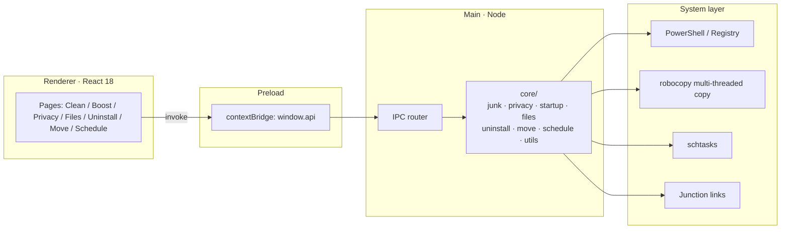

<p align="center">
  
</p>

<p align="center">
  <a href="readme.md">简体中文</a> · <b>English</b>
</p>

<h1 align="center">Pecklean</h1>

<p align="center">
  <b>Clean up your system one peck at a time — like a woodpecker.</b><br/>
  <sub>Free · Clean · No ads · Portable · Fully local</sub>
</p>

<p align="center">
  
  
  
  
  
  
</p>

<p align="center">
  <a href="#-features">Features</a> ·
  <a href="#-why-pecklean">Comparison</a> ·
  <a href="#-architecture">Architecture</a> ·
  <a href="#-quick-start">Quick Start</a> ·
  <a href="#-security">Security</a> ·
  <a href="#-project-structure">Structure</a> ·
  <a href="#-faq">FAQ</a>
</p>

<p align="center">
  <a href="https://github.com/archilau0315/pecklean/releases/latest">
    
  </a>
</p>

---

## ✨ Features

<table>
<tr>
<td width="33%" valign="top">

### 🧹 Junk Cleaner
24 rules covering system caches, browser caches, common app caches and the Recycle Bin. Scan first, then tick the categories you want. Items marked `UAC` are batched into a single elevation prompt.

</td>
<td width="33%" valign="top">

### ⚡ Startup & Processes
Manage startup entries — disabling backs them up instead of deleting, so they can always be restored. Inspect memory hogs and end them.

</td>
<td width="33%" valign="top">

### 🔒 Privacy Cleaner
Run history, recent documents, address-bar history, app usage traces, Chrome / Edge browsing history — 8 categories.

</td>
</tr>
<tr>
<td valign="top">

### 📁 Large & Duplicate Files
Find large files by size. Duplicate search supports **full-disk / selected drives / custom folders**, comparing by size → head hash → MD5.

</td>
<td valign="top">

### 🔀 Folder Migration
Move big folders (WeChat, QQ, …) to another drive and leave a Junction link behind, so apps keep working untouched. No admin rights required.

</td>
<td valign="top">

### 🗑️ Uninstaller
Reads installed apps from the registry, runs each native uninstaller, then scans for leftover registry keys, folders and shortcuts.

</td>
</tr>
<tr>
<td colspan="3" valign="top">

### ⏰ Scheduled Cleaning · Bilingual · Cancellable
Registers a Windows scheduled task for silent background cleaning with logs. Switch between 中文 / EN from the sidebar. While a scan or clean is running, click the button again to cancel it.

</td>
</tr>
</table>

> **No** pop-up ads, no paywall, no bundled installers, no background service — and no file contents ever leave your machine.

---

## 🥇 Why Pecklean

| | Typical cleaner | Pecklean |
|---|---|---|
| Size | 100MB+ installer with extra components | **~81MB single file, copy and run** |
| Ads | Pop-ups, promo slots, software pushes | **Zero ads** |
| Footprint | Background service, auto-start | **No resident process** |
| Privacy | Uploads file lists and usage data | **Fully local, never phones home** |
| Deletion | One-click "clean everything" | **Scan → select → delete** |
| Reversible | Startup items deleted outright | **Disabled items are backed up** |
| Source | Closed | **Open source, audit it yourself** |

---

## 🏗️ Architecture



**Design rule**: the renderer has no Node access. Every system operation lives in the main-process `core/` modules, and destructive paths are validated against a root boundary.

---

## 🚀 Quick Start

### Option 1 — Portable build (recommended)

Download [Pecklean-1.0.0-x64.exe](https://github.com/archilau0315/pecklean/releases/latest) (77.1 MB), double-click to run — no Node.js, no runtime needed. The single file can be copied to any other 64-bit Windows machine.

```text
first launch → self-extract to temp folder (~6–8s) → window appears
```

> The binary is unsigned. If Windows shows "Windows protected your PC", click **More info → Run anyway**.
>
> Optional integrity check: SHA-256 `1436283871B90D5D3415CE5A588C480BE9B6A48212E73E9D777F741613283A53`

### Option 2 — From source

```powershell
npm install          # install dependencies
npm run dev          # dev mode with hot reload
npm run typecheck    # type check
npm run build        # build into out/
npm run dist         # package portable exe into dist/
```

On Windows you can also double-click `启动.bat` in the project root: it checks dependencies, rebuilds and opens the app.

---

## 📖 Usage

| Module | How to use |
|---|---|
| **Junk Cleaner** | Scan → review the list → Clean. The button turns into Cancel while running |
| **Startup & Processes** | Disable / restore startup items; sort processes by memory and end them |
| **Privacy Cleaner** | Tick trace types, scan, clean. Browsers that are still running are skipped with a notice |
| **Large / Duplicate Files** | Pick a scope (full disk / selected drives / custom folders), then set a size floor |
| **Uninstaller** | Select an app → uninstall → leftovers are scanned automatically |
| **Folder Migration** | Pick the source folder, then a destination parent; a same-name folder is created beneath it |
| **Scheduled Cleaning** | Toggle the switch and save; "Run now" verifies it immediately |

Language switching lives at the bottom of the sidebar and is remembered across launches.

---

## 🛡️ Security

- **Scan first, select second, delete last** — only safe, no-admin caches are pre-selected
- Every deletion is validated against its root boundary; out-of-scope paths are skipped
- Startup items are **disabled, not deleted**, backed up under the `SurperCleanDisabled` registry key
- Folder migration has three guards: `robocopy` copy → file-count and byte-by-byte verification → automatic rollback on mismatch
- Leftover scanning detects "app still installed" and only lists items instead of pre-selecting them
- Browser history cleaning checks for running browser processes and skips if found
- Scheduled cleaning only runs no-elevation items, so it never triggers UAC at night
- Scans and cleans can be **cancelled mid-flight** without leaving partial state

---

## 📂 Project Structure

```text
pecklean/
├─ src/
│  ├─ main/                  # main process (all system work)
│  │  ├─ index.ts            # entry; --autoclean silent mode
│  │  ├─ lang.ts             # bilingual messages for main process
│  │  ├─ ipc.ts              # IPC channel registration
│  │  └─ core/
│  │     ├─ utils.ts         # formatting, path expansion, safe delete, PowerShell, UAC, MD5
│  │     ├─ junkRules.ts     # 24 cleanup rules (edit here to add more)
│  │     ├─ junk.ts          # junk scan & clean (cancellable)
│  │     ├─ privacy.ts       # privacy trace scan & clean
│  │     ├─ startup.ts       # startup entries and processes
│  │     ├─ files.ts         # large files, duplicates (multi-root dedupe)
│  │     ├─ uninstall.ts     # app list, uninstall, leftovers
│  │     ├─ move.ts          # folder migration (copy → verify → Junction)
│  │     └─ schedule.ts      # scheduled cleaning config & task
│  ├─ preload/index.ts       # contextBridge exposes window.api
│  ├─ renderer/src/          # UI
│  │  ├─ App.tsx             # layout and sidebar navigation
│  │  ├─ pages/              # 8 feature pages
│  │  ├─ i18n/               # zh / en dictionaries (182 keys each)
│  │  └─ styles.css          # dark theme
│  ├─ shared/types.ts        # shared types
│  └─ build/                 # app icon (icon.ico, 6 sizes)
├─ out/                      # build output
├─ dist/                     # packaged artifacts (git-ignored)
└─ debug_log_1.md            # change log
```

### Module cheat sheet

| File | Responsibility |
|---|---|
| `core/utils.ts` | `expand` / `resolveGlob` / `deletePath` / `walkFiles` / `runPowerShell` / `runElevated` / `md5File` |
| `core/junk.ts` | rule-driven scan; batches admin items into one elevation; Recycle Bin via `Clear-RecycleBin` |
| `core/privacy.ts` | 8 trace categories; exports `PRIVACY_IDS` reused by scheduled cleaning |
| `core/uninstall.ts` | three Uninstall registry roots; MSI silent `/x /qn`; normalized-name leftover matching |
| `core/move.ts` | presets, drive list, free-space check, robocopy progress, Junction creation and rollback |
| `core/schedule.ts` | config in `userData/schedule.json`; `schtasks` registration; logs to `autoclean.log` |

---

## ❓ FAQ

<details>
<summary><b>"Windows protected your PC" on launch</b></summary>

The binary has no code-signing certificate, so SmartScreen warns about unsigned executables. Choose "More info → Run anyway"; it won't ask again.
</details>

<details>
<summary><b>Why do some items carry a UAC badge?</b></summary>

They touch system folders or need elevation. All UAC items are combined into a **single** prompt.
</details>

<details>
<summary><b>Folder migration failed — what now?</b></summary>

- Close any app using the folder (WeChat / QQ / browser …)
- Make sure the destination drive has more free space than the source size
- If the destination already contains a **non-empty** same-name folder, choose another parent; empty folders are fine
</details>

<details>
<summary><b>Does cancelling leave files half-deleted?</b></summary>

No. Cancellation is checked per item: completed items finish, pending ones are skipped. During UAC elevation the process can't be killed, so cancellation takes effect right after that step.
</details>

<details>
<summary><b>Does it upload anything?</b></summary>

No. The app never connects to the network; results stay in local memory and log files.
</details>

---

## 🗺️ Roadmap

- [x] Eight modules · bilingual UI · portable single file
- [x] Cancellable scan / clean tasks
- [x] Three duplicate-search scopes
- [ ] Smart health report: space attribution, reclaimable size, risk levels
- [ ] Perceptual-hash image similarity with keep-recommendations
- [ ] Optional MCP interface to plug Pecklean into your own AI client

---

## 📄 Notes

- Quit apps that are using the target folder before migrating or uninstalling
- The scheduled task is named `SurperClean_AutoClean` and can be inspected in Task Scheduler
- Startup backups, schedule config and cleaning logs live in your user folder, never in sensitive system locations

---

<p align="center">
  <sub>
    <b>Kuanform Boundless · Archilau Studio</b> (匡形无界 · 啄之堂)<br/>
    Personal project · not for commercial distribution · evaluate the risks before use
  </sub>
</p>
