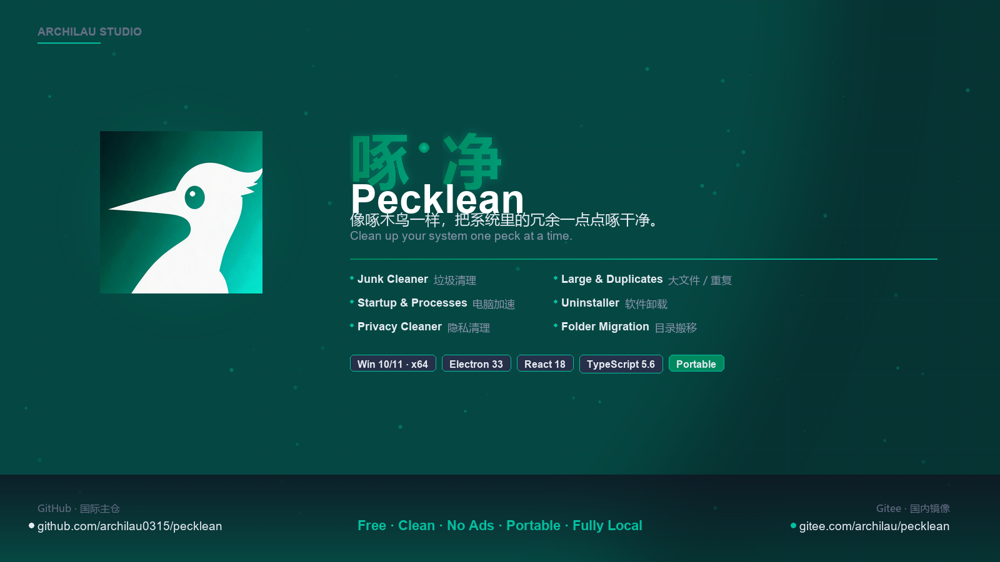
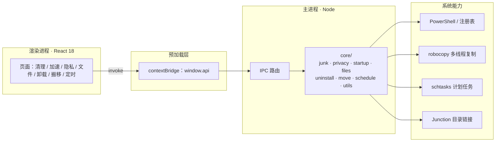
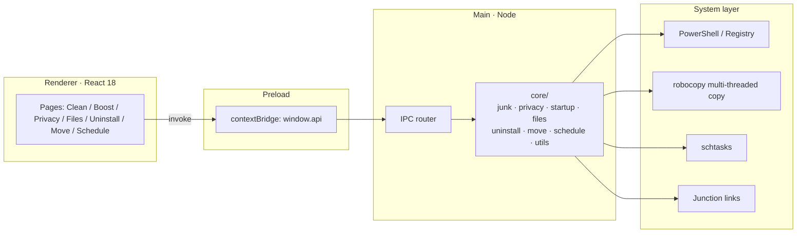

<p align="center">
  
</p>

<h1 align="center">啄 · 净 &nbsp;Pecklean</h1>

<p align="center">
  <b>像啄木鸟一样，把系统里的冗余一点点啄干净。</b><br/>
  <sub>Clean up your system one peck at a time — like a woodpecker.</sub><br/>
  <sub>免费 · 纯净 · 无广告 · 免安装 · 全程本地运行<br/>
  Free · Clean · No ads · Portable · Fully local</sub>
</p>

<p align="center">
  
  
  
  
  
  
</p>

<p align="center">
  <a href="https://github.com/archilau0315/pecklean/releases/latest">
    
  </a>
</p>

<p align="center">
  <b>简体中文</b> · <a href="#english">English</a>
</p>

<p align="center">
  
</p>

---

## 中文

<p>
  <a href="#-核心特性">核心特性</a> ·
  <a href="#-为什么是啄净">对比</a> ·
  <a href="#-架构">架构</a> ·
  <a href="#-快速开始">快速开始</a> ·
  <a href="#-安全设计">安全设计</a> ·
  <a href="#-项目结构">项目结构</a> ·
  <a href="#-常见问题">FAQ</a>
</p>

### ✨ 核心特性

<table>
<tr>
<td width="33%" valign="top">

#### 🧹 垃圾清理
24 条清理规则覆盖系统缓存、浏览器缓存、常用软件缓存与回收站。扫描后按分类勾选，带 `UAC` 徽章的系统项合并成一次提权。

</td>
<td width="33%" valign="top">

#### ⚡ 电脑加速
管理开机启动项，禁用不删除、随时可恢复；查看高占用进程并一键结束。

</td>
<td width="33%" valign="top">

#### 🔒 隐私清理
运行历史、最近文档、地址栏记录、程序使用痕迹、Chrome / Edge 浏览历史，共 8 类。

</td>
</tr>
<tr>
<td valign="top">

#### 📁 大文件 / 重复文件
按体积找大文件；重复文件支持**全盘全量 / 指定磁盘 / 指定文件夹**三种范围，按「大小 → 头部哈希 → MD5」三级比对。

</td>
<td valign="top">

#### 🔀 目录搬移
微信、QQ 等大目录整体搬到其他盘，原位置建立 Junction 链接，软件路径无感，无需管理员权限。

</td>
<td valign="top">

#### 🗑️ 软件卸载
读取注册表已装软件，一键调用原生卸载程序，并扫描注册表 / 目录 / 快捷方式残留。

</td>
</tr>
<tr>
<td colspan="3" valign="top">

#### ⏰ 定时清理 · 中英双语 · 任务可取消
注册 Windows 计划任务，每天固定时间后台静默清理，日志可查；侧边栏「中文 / EN」一键切换；扫描与清理过程中再点一次按钮即可取消当前任务。

</td>
</tr>
</table>

> **没有**广告弹窗、付费墙、捆绑安装、常驻后台进程，也不会上传任何文件内容。

### 🥇 为什么是啄净

| 维度 | 常见清理软件 | 啄净 Pecklean |
|---|---|---|
| 体积 | 100MB+ 安装包，附带多个组件 | **单文件 ~81MB，复制即用** |
| 广告 | 弹窗、推荐位、软件推广 | **零广告** |
| 权限 | 常驻后台服务、开机自启 | **不常驻，用完即走** |
| 隐私 | 上传文件清单与使用数据 | **全程本地，不出网** |
| 删除策略 | 一键全删、难以干预 | **先扫描 → 再勾选 → 后删除** |
| 可逆性 | 启动项直接删除 | **禁用即备份，可随时恢复** |
| 开源 | 闭源 | **源码公开，可自行审计与重打包** |

### 🏗️ 架构



**设计原则**：渲染进程无 Node 权限，所有系统操作收敛在主进程 `core/`，界面只负责展示与交互。危险操作统一走根目录边界校验。

### 🚀 快速开始

#### 国内镜像（推荐）

代码托管双镜像，根据网络情况任选其一：

| 镜像 | 地址 | 面向 |
|---|---|---|
| **Gitee · 国内镜像** | <https://gitee.com/archilau/pecklean> | 中国大陆访问 |
| **GitHub · 国际主仓** | <https://github.com/archilau0315/pecklean> | 海外与开源社区 |

两仓代码保持同步，Commit SHA 一致。

#### 方式一：免安装版（推荐）

直接下载：[Pecklean-2.0.0-x64.exe](https://github.com/archilau0315/pecklean/releases/latest)（77.1 MB），双击即用，无需安装 Node.js 或任何运行库。单个文件复制到其它 64 位 Windows 电脑上也能直接运行。

```text
首次启动 → 自解压到临时目录（约 6~8 秒）→ 窗口出现
```

> 程序未做数字签名。若弹出「Windows 已保护你的电脑」，点 **更多信息 → 仍要运行** 即可。
>
> 校验完整性（可选）：SHA-256 `1436283871B90D5D3415CE5A588C480BE9B6A48212E73E9D777F741613283A53`

#### 方式二：源码运行

```powershell
npm install          # 首次安装依赖
npm run dev          # 开发调试（热更新）
npm run typecheck    # 类型检查
npm run build        # 构建到 out/
npm run dist         # 打包免安装 exe → dist/
```

Windows 用户也可直接双击根目录的 `启动.bat`，脚本会自动检查依赖、重新构建并打开窗口。

### 📖 使用说明

| 模块 | 操作要点 |
|---|---|
| **垃圾清理** | 「开始扫描」→ 确认列表 → 「一键清理」。执行中按钮变为「取消扫描 / 取消清理」，再点一次即可中止 |
| **电脑加速** | 启动项可禁用 / 恢复；进程列表支持按内存排序后结束 |
| **隐私清理** | 勾选痕迹类型后扫描，浏览器未退出时会跳过并提示 |
| **大文件 / 重复** | 重复文件先选范围（全盘 / 指定磁盘 / 指定文件夹），再设置体积下限 |
| **软件卸载** | 选中软件 → 卸载 → 自动扫描残留；「扫描残留」可随时手动触发 |
| **目录搬移** | 选原目录 → 选存放位置（程序在其下建同名文件夹）→ 开始搬移，完成后原位置变链接 |
| **定时清理** | 勾选开关并保存，计划任务写入系统；「立即运行一次」可先验证效果 |

界面语言在侧边栏底部切换，选择会保存到本地，下次启动保持。

### 🛡️ 安全设计

- **先扫描、后勾选、再删除**，默认只选中无需管理员权限的安全缓存项
- 删除操作带根目录边界校验，任何越界路径直接跳过
- 启动项**禁用不删除**，备份到注册表 `SurperCleanDisabled` 键，可随时恢复
- 目录搬移三重保护：`robocopy` 复制 → 文件数与总字节逐一校验 → 校验失败自动回滚
- 卸载残留扫描会识别「软件仍处于安装状态」，此时只列出、不默认勾选
- 浏览器历史清理前检测浏览器进程，未退出则跳过并提示
- 定时清理只执行免提权项目，不会在深夜弹出 UAC
- 清理与扫描均支持**中途取消**，取消后不会留下半成品状态

### 📂 项目结构

```text
pecklean/
├─ src/
│  ├─ main/                  # 主进程（系统操作全部在这里）
│  │  ├─ index.ts            # 入口；--autoclean 静默模式
│  │  ├─ lang.ts             # 主进程中文 / 英文消息
│  │  ├─ ipc.ts              # IPC 通道统一注册
│  │  └─ core/
│  │     ├─ utils.ts         # 格式化、路径展开、安全删除、PowerShell、UAC、MD5
│  │     ├─ junkRules.ts     # 24 条垃圾清理规则（加规则改这里）
│  │     ├─ junk.ts          # 垃圾扫描与清理（含取消）
│  │     ├─ privacy.ts       # 隐私痕迹扫描与清理
│  │     ├─ startup.ts       # 启动项、进程管理
│  │     ├─ files.ts         # 大文件、重复文件（多根扫描去重）
│  │     ├─ uninstall.ts     # 软件列表、卸载、残留清理
│  │     ├─ move.ts          # 目录搬移（复制 → 校验 → Junction）
│  │     └─ schedule.ts      # 定时清理配置与计划任务
│  ├─ preload/index.ts       # contextBridge 暴露 window.api
│  ├─ renderer/src/          # 界面
│  │  ├─ App.tsx             # 布局与侧边导航
│  │  ├─ pages/              # 8 个功能页面
│  │  ├─ i18n/               # 中英词典（各 182 key）
│  │  └─ styles.css          # 暗色主题
│  ├─ shared/types.ts        # 主/渲染共享类型
│  └─ build/                 # 应用图标（icon.ico 六档尺寸）
├─ out/                      # 构建产物
├─ dist/                     # 打包产物（不提交 git）
└─ debug_log_1.md            # 变更记录
```

#### 模块职责速查

| 文件 | 关键职责 |
|---|---|
| `core/utils.ts` | `expand` / `resolveGlob` / `deletePath` / `walkFiles` / `runPowerShell` / `runElevated` / `md5File` |
| `core/junk.ts` | 规则驱动扫描；管理员项合并提权；回收站走 `Clear-RecycleBin` |
| `core/privacy.ts` | 8 类隐私痕迹；导出 `PRIVACY_IDS` 供定时清理复用 |
| `core/uninstall.ts` | 三处 Uninstall 注册表根；MSI 静默 `/x /qn`；残留按名称归一化匹配 |
| `core/move.ts` | 常用目录预设、磁盘列表、空间校验、robocopy 进度、Junction 建立与回滚 |
| `core/schedule.ts` | 配置存 `userData/schedule.json`；`schtasks` 注册；日志写 `autoclean.log` |

### ❓ 常见问题

<details>
<summary><b>启动时提示「Windows 已保护你的电脑」</b></summary>

程序没有数字签名证书，SmartScreen 会对未签名 exe 提示。点「更多信息 → 仍要运行」即可，后续不再提示。
</details>

<details>
<summary><b>为什么有些项目带 UAC 徽章？</b></summary>

涉及系统目录或需要提升权限的项。所有 UAC 项会合并成**一次**提权确认，不会反复弹窗。
</details>

<details>
<summary><b>目录搬移失败怎么办？</b></summary>

- 先退出正在使用该目录的程序（微信 / QQ / 浏览器等）
- 确认目标盘剩余空间大于源目录体积
- 目标位置下若已存在**同名且有内容**的文件夹，换一个存放位置即可；空文件夹可直接使用
</details>

<details>
<summary><b>取消任务后会不会删一半？</b></summary>

不会。取消是逐项检查的中断，已完成的项正常结束，未开始的跳过；提权阶段（UAC）无法强杀，取消会在该步骤结束后生效。
</details>

<details>
<summary><b>会不会上传我的文件信息？</b></summary>

不会。程序不联网，所有扫描结果只在本机内存与日志文件中。
</details>

### 🗺️ 路线图

- [x] 八大模块 · 中英双语 · 免安装单文件
- [x] 扫描 / 清理任务可取消
- [x] 重复文件三种搜索范围
- [ ] 智能体检报告：占用归因 + 可释放空间 + 风险分级
- [ ] 相似图片识别（感知哈希），自动推荐保留项
- [ ] 可选 MCP 接口，把能力开放给用户自己的 AI 客户端

### 📄 说明

- 搬移或卸载前，请先退出正在使用目标目录的程序
- 计划任务名为 `SurperClean_AutoClean`，可在「任务计划程序」中随时查看或停用
- 禁用启动项、定时配置、清理日志都保存在用户目录，不写入系统敏感位置

---

## English

<p>
  <a href="#-features">Features</a> ·
  <a href="#-why-pecklean">Why Pecklean</a> ·
  <a href="#-architecture">Architecture</a> ·
  <a href="#-quick-start">Quick Start</a> ·
  <a href="#-security">Security</a> ·
  <a href="#-project-structure">Structure</a> ·
  <a href="#-faq">FAQ</a>
</p>

### ✨ Features

<table>
<tr>
<td width="33%" valign="top">

#### 🧹 Junk Cleaner
24 rules covering system caches, browser caches, common app caches and the Recycle Bin. Scan first, then tick the categories you want. Items marked `UAC` are batched into a single elevation prompt.

</td>
<td width="33%" valign="top">

#### ⚡ Startup & Processes
Manage startup entries — disabling backs them up instead of deleting, so they can always be restored. Inspect memory hogs and end them.

</td>
<td width="33%" valign="top">

#### 🔒 Privacy Cleaner
Run history, recent documents, address-bar history, app usage traces, Chrome / Edge browsing history — 8 categories.

</td>
</tr>
<tr>
<td valign="top">

#### 📁 Large & Duplicate Files
Find large files by size. Duplicate search supports **full disk / selected drives / custom folders**, comparing by size → head hash → MD5.

</td>
<td valign="top">

#### 🔀 Folder Migration
Move big folders (WeChat, QQ, …) to another drive and leave a Junction link behind, so apps keep working untouched. No admin rights required.

</td>
<td valign="top">

#### 🗑️ Uninstaller
Reads installed apps from the registry, runs each native uninstaller, then scans for leftover registry keys, folders and shortcuts.

</td>
</tr>
<tr>
<td colspan="3" valign="top">

#### ⏰ Scheduled Cleaning · Bilingual · Cancellable
Registers a Windows scheduled task for silent background cleaning with logs. Switch between 中文 / EN from the sidebar. While a scan or clean is running, click the button again to cancel it.

</td>
</tr>
</table>

> **No** pop-up ads, no paywall, no bundled installers, no background service — and no file contents ever leave your machine.

### 🥇 Why Pecklean

| | Typical cleaner | Pecklean |
|---|---|---|
| Size | 100MB+ installer with extra components | **~81MB single file, copy and run** |
| Ads | Pop-ups, promo slots, software pushes | **Zero ads** |
| Footprint | Background service, auto-start | **No resident process** |
| Privacy | Uploads file lists and usage data | **Fully local, never phones home** |
| Deletion | One-click "clean everything" | **Scan → select → delete** |
| Reversible | Startup items deleted outright | **Disabled items are backed up** |
| Source | Closed | **Open source, audit it yourself** |

### 🏗️ Architecture



**Design rule**: the renderer has no Node access. Every system operation lives in the main-process `core/` modules, and destructive paths are validated against a root boundary.

### 🚀 Quick Start

#### Mirrored repos

Code is mirrored to two hosts — pick whichever works better for you:

| Mirror | URL | Audience |
|---|---|---|
| **Gitee · CN mirror** | <https://gitee.com/archilau/pecklean> | Mainland China |
| **GitHub · primary** | <https://github.com/archilau0315/pecklean> | Rest of the world |

Both stay in sync with matching commit SHAs.

#### Option 1 — Portable build (recommended)

Download [Pecklean-2.0.0-x64.exe](https://github.com/archilau0315/pecklean/releases/latest) (77.1 MB), double-click to run — no Node.js, no runtime needed. The single file can be copied to any other 64-bit Windows machine.

```text
first launch → self-extract to temp folder (~6–8s) → window appears
```

> The binary is unsigned. If Windows shows "Windows protected your PC", click **More info → Run anyway**.
>
> Optional integrity check: SHA-256 `1436283871B90D5D3415CE5A588C480BE9B6A48212E73E9D777F741613283A53`

#### Option 2 — From source

```powershell
npm install          # install dependencies
npm run dev          # dev mode with hot reload
npm run typecheck    # type check
npm run build        # build into out/
npm run dist         # package portable exe into dist/
```

On Windows you can also double-click `启动.bat` in the project root: it checks dependencies, rebuilds and opens the app.

### 📖 Usage

| Module | How to use |
|---|---|
| **Junk Cleaner** | Scan → review the list → Clean. The button turns into Cancel while running |
| **Startup & Processes** | Disable / restore startup items; sort processes by memory and end them |
| **Privacy Cleaner** | Tick trace types, scan, clean. Browsers that are still running are skipped with a notice |
| **Large / Duplicate Files** | Pick a scope (full disk / selected drives / custom folders), then set a size floor |
| **Uninstaller** | Select an app → uninstall → leftovers are scanned automatically |
| **Folder Migration** | Pick the source folder, then a destination parent; a same-name folder is created beneath it |
| **Scheduled Cleaning** | Toggle the switch and save; "Run now" verifies it immediately |

Language switching lives at the bottom of the sidebar and is remembered across launches.

### 🛡️ Security

- **Scan first, select second, delete last** — only safe, no-admin caches are pre-selected
- Every deletion is validated against its root boundary; out-of-scope paths are skipped
- Startup items are **disabled, not deleted**, backed up under the `SurperCleanDisabled` registry key
- Folder migration has three guards: `robocopy` copy → file-count and byte-by-byte verification → automatic rollback on mismatch
- Leftover scanning detects "app still installed" and only lists items instead of pre-selecting them
- Browser history cleaning checks for running browser processes and skips if found
- Scheduled cleaning only runs no-elevation items, so it never triggers UAC at night
- Scans and cleans can be **cancelled mid-flight** without leaving partial state

### 📂 Project Structure

```text
pecklean/
├─ src/
│  ├─ main/                  # main process (all system work)
│  │  ├─ index.ts            # entry; --autoclean silent mode
│  │  ├─ lang.ts             # bilingual messages for main process
│  │  ├─ ipc.ts              # IPC channel registration
│  │  └─ core/
│  │     ├─ utils.ts         # formatting, path expansion, safe delete, PowerShell, UAC, MD5
│  │     ├─ junkRules.ts     # 24 cleanup rules (edit here to add more)
│  │     ├─ junk.ts          # junk scan & clean (cancellable)
│  │     ├─ privacy.ts       # privacy trace scan & clean
│  │     ├─ startup.ts       # startup entries and processes
│  │     ├─ files.ts         # large files, duplicates (multi-root dedupe)
│  │     ├─ uninstall.ts     # app list, uninstall, leftovers
│  │     ├─ move.ts          # folder migration (copy → verify → Junction)
│  │     └─ schedule.ts      # scheduled cleaning config & task
│  ├─ preload/index.ts       # contextBridge exposes window.api
│  ├─ renderer/src/          # UI
│  │  ├─ App.tsx             # layout and sidebar navigation
│  │  ├─ pages/              # 8 feature pages
│  │  ├─ i18n/               # zh / en dictionaries (182 keys each)
│  │  └─ styles.css          # dark theme
│  ├─ shared/types.ts        # shared types
│  └─ build/                 # app icon (icon.ico, 6 sizes)
├─ out/                      # build output
├─ dist/                     # packaged artifacts (git-ignored)
└─ debug_log_1.md            # change log
```

#### Module cheat sheet

| File | Responsibility |
|---|---|
| `core/utils.ts` | `expand` / `resolveGlob` / `deletePath` / `walkFiles` / `runPowerShell` / `runElevated` / `md5File` |
| `core/junk.ts` | rule-driven scan; batches admin items into one elevation; Recycle Bin via `Clear-RecycleBin` |
| `core/privacy.ts` | 8 trace categories; exports `PRIVACY_IDS` reused by scheduled cleaning |
| `core/uninstall.ts` | three Uninstall registry roots; MSI silent `/x /qn`; normalized-name leftover matching |
| `core/move.ts` | presets, drive list, free-space check, robocopy progress, Junction creation and rollback |
| `core/schedule.ts` | config in `userData/schedule.json`; `schtasks` registration; logs to `autoclean.log` |

### ❓ FAQ

<details>
<summary><b>"Windows protected your PC" on launch</b></summary>

The binary has no code-signing certificate, so SmartScreen warns about unsigned executables. Choose "More info → Run anyway"; it won't ask again.
</details>

<details>
<summary><b>Why do some items carry a UAC badge?</b></summary>

They touch system folders or need elevation. All UAC items are combined into a **single** prompt.
</details>

<details>
<summary><b>Folder migration failed — what now?</b></summary>

- Close any app using the folder (WeChat / QQ / browser …)
- Make sure the destination drive has more free space than the source size
- If the destination already contains a **non-empty** same-name folder, choose another parent; empty folders are fine
</details>

<details>
<summary><b>Does cancelling leave files half-deleted?</b></summary>

No. Cancellation is checked per item: completed items finish, pending ones are skipped. During UAC elevation the process can't be killed, so cancellation takes effect right after that step.
</details>

<details>
<summary><b>Does it upload anything?</b></summary>

No. The app never connects to the network; results stay in local memory and log files.
</details>

### 🗺️ Roadmap

- [x] Eight modules · bilingual UI · portable single file
- [x] Cancellable scan / clean tasks
- [x] Three duplicate-search scopes
- [ ] Smart health report: space attribution, reclaimable size, risk levels
- [ ] Perceptual-hash image similarity with keep-recommendations
- [ ] Optional MCP interface to plug Pecklean into your own AI client

### 📄 Notes

- Quit apps that are using the target folder before migrating or uninstalling
- The scheduled task is named `SurperClean_AutoClean` and can be inspected in Task Scheduler
- Startup backups, schedule config and cleaning logs live in your user folder, never in sensitive system locations

---

<p align="center">
  <sub>
    <b>匡形无界 · 啄之堂</b>（Kuanform Boundless · Archilau Studio）<br/>
    个人自用项目 · 不提供商业分发 · 使用前请自行评估风险<br/>
    Personal project · not for commercial distribution · evaluate the risks before use
  </sub>
</p>
